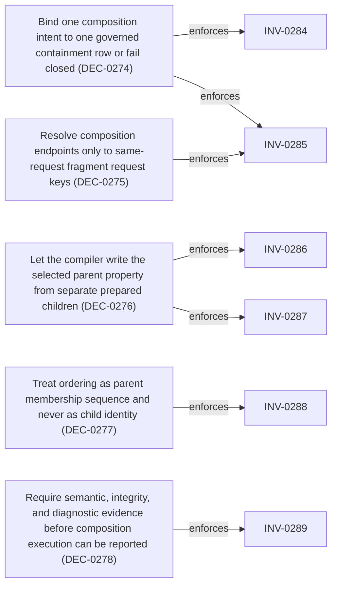

<!--
integrity_schema_version: 1
generated: deterministic_projection_v1
artifact_kind: rendered_adr_markdown
generator_id: adr-projection-markdown
generator_version: 3
hash_algorithm: sha256
source_hash: 5051d927abb31a6ed788e2763c4f71170d34556442d855187944c276d6443088
rendered_hash: 8a2e5d4ca6f983778d78f0eaece7cd92b13944faaa924556e753dc249f37b392
-->

# ADR-L-0035: Governed Composition-Intent Binding for Authoring Construction

## Identity / Status

**Type:** logical 
**Status:** proposed 
**Alias:** ADR-L-0035 
**Authoring contract:** authoring v1.5 
**Created:** 2026-10-18 
**Authors:** erik.gallmann 
**Domains:** architecture, authoring, semantic-authority, determinism, conformance 
**Tags:** authoring-construction, composition-intent, authoring-1.7, architecture-interpretation-1.2, proposed-authority 

## Architecture at a Glance

| | |
| --- | --- |
| Logical authority | ADR-L-0035 |
| Status | proposed |
| Decisions | 5 |
| Invariants | 6 |

## Context

ACC 1.1 accepts a composition intent of parent, child, relation, and
ordering, then fails closed. Accepted authority already requires
composition to preserve child identity, to omit an exactly embedded child
from minimal source roots, and to treat composition ownership as semantic
provenance distinct from integrity evidence. It does not select one
Authoring 1.7 property, one Architecture Interpretation 1.2 semantic field,
one endpoint resolution rule, or one owner of the embedded bytes.

ADC 1.1 permits entity/decision under adr/logical and declares that child
an identity-keyed set whose presentation order is not identity. AI 1.2
declares adr/logical#/decisions an ordered sequence of child identities.
Those statements govern different facts. Neither statement, nor schema
occurrence of a decision object, interprets composition_intent.ordering or
the relation token.

Historical ACC 1.0 uses the token contains in frozen conformance and
describes endpoints as a request key or exact reference. Its historical
execution ignores relation and rewrites some child fields. That behavior
remains historical authority for unchanged C01-C42 only. It is not ACC 1.1
construction authority, and this decision does not carry that behavior forward.

This ADR defines the minimum binding for one parent and child capability.
It does not execute composition, amend a published contract, or change
semantic-core protocol 1.5. Frozen ACC 1.1 does not contain this row in
its qualified closure. That missing qualification is a blocking gap.
Status remains proposed.
## Architectural Decisions

| Decision | Choice | Traceability |
| --- | --- | --- |
| DEC-0274 | Bind one composition intent to one governed containment row or fail closed | Related INV-0284, INV-0285 |
| DEC-0275 | Resolve composition endpoints only to same-request fragment request keys | Related INV-0285 |
| DEC-0276 | Let the compiler write the selected parent property from separate prepared children | Related INV-0286, INV-0287 |
| DEC-0277 | Treat ordering as parent membership sequence and never as child identity | Related INV-0288 |
| DEC-0278 | Require semantic, integrity, and diagnostic evidence before composition execution can be reported | Related INV-0289 |

### DEC-0274 — Bind one composition intent to one governed containment row or fail closed

**Rationale**

A composition intent is the tuple {parent, child, relation, ordering}.
Execution MAY succeed only when that tuple selects exactly one row of the
binding matrix below. The row selects exactly one Authoring 1.7 property
and exactly one AI 1.2 semantic_field_key. Schema uniqueness, a historical
renderer, and an open relation pattern are not selectors.

The closed relation vocabulary of this ADR is the single token contains.
For the initial row, contains means that the child definition is a member
of the selected parent property. It is not a normalized relationship type,
not composed_of, and not permission to embed the child in any other
property. ACC 1.0 execution that ignored relation, embedded every logical
child into decisions, rewrote aliases, or rewrote rationales is rejected
as the meaning of this token.

The initial matrix has one row and no others:

parent semantic type: adr/logical
child semantic type: entity/decision
relation: contains
Authoring 1.7 property: decisions
Authoring pointer: /decisions
AI 1.2 semantic_field_key: adr/logical#/decisions
AI ordering: ordered_sequence
AI destination: child_membership
AI identity match: child_uuid
AI multiplicity: reject_duplicate_identity
AI value semantics: child_identity_membership
child identity: canonical UUIDv7, not positional
byte owner: compiler, and only when the prepared parent lacks decisions
endpoint resolution: exactly one same-request fragment request_key

A later accepted ADR MAY add rows. It MUST NOT change this row without
superseding this decision. This ADR does not declare rows for the other
semantic types.

The selected row is consistent with published ADC 1.1 and AI 1.2, and
execution MUST re-check that consistency against the qualified resources.
The child composition policy MUST name the parent in allowed_parents,
use mode fragment_composition, and preserve child identity. The parent
composition policy MUST use mode root_fragment. The qualified AI
disposition for adr/logical#/decisions MUST remain child_membership,
ordered_sequence, child_uuid, reject_duplicate_identity, and
child_identity_membership. Disagreement is Unavailable. Execution MUST
NOT override the resource and MUST NOT choose a different field.

Fragment composition_keys do not identify a composition, a property, or
a child. They have no governed target. A non-empty composition_keys array
on any fragment makes the request Unavailable.

Outcome aggregation follows immutable ACC 1.1 precedence: Rejected, then
Unavailable, then Unresolved, then Constructed. Any independently
established Rejected violation rejects the request. Otherwise any
Unavailable composition or missing capability leaves the request
Unavailable. Otherwise any Unresolved composition leaves the request
Unresolved. Otherwise every composition is bound by a matrix row.
Constructed remains unauthorized by this proposed ADR. Partial embedding
is forbidden. Empty compositions remain the existing non-composition path
and are outside this binding. Every independently discoverable diagnostic
is retained, including a diagnostic whose status does not win the outcome.

Mixed example: one composition is Unavailable because the resolved types
have no matrix row, and another is Unresolved because an endpoint matches
no request_key. No Rejected violation is present. The request outcome is
Unavailable, and both diagnostics are retained. A further unknown relation
in that same request is an independent Rejected violation, so the outcome
becomes Rejected while the Unavailable and Unresolved diagnostics remain.

Closed cases:

Unknown relation, including composed_of: Rejected,
authoring_construction.composition.relation_unknown.
Known relation with no matrix row for the resolved types: Unavailable,
authoring_construction.composition.binding_unavailable.
Qualified ADC or AI resource disagrees with the selected row: Unavailable,
authoring_construction.composition.authority_inconsistent.
Non-empty composition_keys: Unavailable,
authoring_construction.composition.key_unbound.
Endpoint matches no request_key and no request-visible reference identity:
Unresolved, authoring_construction.composition.endpoint_unresolved.
Endpoint equals a fragment reference key or target, or a reference-basis
reference_id or canonical UUID, and is not one create request_key:
Rejected, authoring_construction.composition.reference_not_definition.
That equality recognizes a reference. It does not resolve or copy it.
Endpoint matches more than one request_key: Rejected,
authoring_construction.composition.endpoint_ambiguous.
Parent or child operation is reference: Rejected,
authoring_construction.composition.reference_not_definition.
Parent or child operation is retire: Rejected,
authoring_construction.composition.operation_unsupported.
Parent or child operation is update: Unavailable,
authoring_construction.composition.update_unavailable.
Parent or child input_mode is compact: Unavailable,
authoring_construction.fragment.compact_unavailable.
ACC 1.1 admits compact as an input mode. Accepted DEC-0188 treats compact
input as compression that must not invent material intent, and PR #163
reports Unavailable because the source transformation is not defined by
executable authority. Compact input is that missing capability. It is not
a semantic violation, and this ADR does not create a prohibition to make
it one.
Parent and child are the same fragment, or the containment edges cycle:
Rejected, authoring_construction.composition.cycle.
The same parent and child pair occurs more than once: Rejected,
authoring_construction.composition.duplicate_membership.
The same child identity is bound to more than one parent, or any fragment
canonical UUID is repeated: Rejected,
authoring_construction.composition.duplicate_identity.
Two children of one parent field share an ordering value: Rejected,
authoring_construction.composition.ordering_conflict.
The prepared parent contains the selected property, including an empty
array or null: Rejected,
authoring_construction.composition.ownership_conflict.

Diagnostics use the ACC 1.1 sort key. Until a semantic unit UUID exists,
the identity component is the stable unresolved sentinel and the request
key remains integrity payload. All applicable diagnostics are retained.

**Alternatives Considered**

| Alternative | Rejected because |
| --- | --- |
| Import ACC 1.0 request-key-or-exact-reference and ignore relation | ACC 1.1 does not restate that endpoint rule, and the historical renderer is not a relation or field selector. Importing it would publish an interpreter this authority rejects. |
| Treat contains as generic containment into any child array | The token is not a property name. A generic reading would invent a second field selector beside the binding row and AI 1.2. |

**Consequences**

Positive:
- One request tuple has one auditable containment or a named failure.
- Later parent and child pairs can be added as rows without redefining contains or this row.

Negative:
- Every pair outside the initial row remains Unavailable, including pairs ADC already permits.
- Reference endpoints and update merges are not available in this capability.

**Traceability**
- Related invariants: INV-0284
- Related invariants: INV-0285

### DEC-0275 — Resolve composition endpoints only to same-request fragment request keys

**Rationale**

For this capability, parent and child MUST each equal exactly one
fragment request_key in the same construction request. The match is exact
string equality. The successful path uses operation create and input_mode
prepared. Compact input stays schema-valid and is Unavailable under
DEC-0274. The parent fragment semantic type MUST be adr/logical.
The child fragment semantic type MUST be entity/decision. Parent and child
request keys MUST differ.

The resolver MUST NOT bind an endpoint through a fragment reference, a
sealed reference-basis entry, an alias, a canonical UUID, a source path,
or a source_ref. Consulting those identities to copy bytes or to accept
the endpoint is forbidden. Recognizing that an unbound string equals one
of those reference identities is only the Rejected diagnostic in
DEC-0274. A reference never becomes a definition.

Request-array position is not an endpoint and is not precedence. There is
no fallback from an unresolved request_key to another identifier space.

**Traceability**
- Related invariants: INV-0285

### DEC-0276 — Let the compiler write the selected parent property from separate prepared children

**Rationale**

This ADR selects compiler-owned containment and rejects both verification
of a pre-written child and any combination of the two writers.

The composition intent is the sole authority for membership of the
selected property. The child definition is a separate prepared fragment.
After identity establishment, the compiler inserts the child's complete
canonical object into the parent property. The prepared parent MUST NOT
already contain that property. Absence means the key is not present.
An empty array, null, or any other value is a conflicting prepared writer
and is Rejected. Exact equality between a prepared value and the
compiler result is not acceptance and is not a second success path.

The child canonical object is the prepared child fields plus the one
established child id and no other key. Identity establishment is the
existing create rule: preserve a supplied UUIDv7, or mint one UUIDv7 when
create omits id. Composition MUST NOT mint a second id, derive an id, or
replace an id while embedding. The embedded id MUST equal the child
candidate identity.

Every other child field is preserved exactly, including alias_id,
alias_name, summary, rationale, and every optional decision field present
on the prepared child. The compiler MUST NOT add, remove, rename, retype,
default, or rewrite a child field. It MUST NOT fabricate an alias, rewrite
a rationale, or infer meaning that the child fields do not already state.
Optional fields that the author omitted stay omitted. Serialization key
order belongs to the existing adr-kit.authoring-yaml/v1 profile and is not
a semantic edit. JSON deep equality after that canonical parse is the
equality test. A loss, addition, or rewrite is Rejected,
authoring_construction.composition.child_mutation. An embedded id that
differs from the child candidate id is Rejected,
authoring_construction.composition.identity_mutation.

Parent fields other than the selected property are copied unchanged. The
only authorized parent mutations are establishment of the parent id and
insertion of the selected array. The compiler MUST NOT invent
schema_version, context, title, aliases, or any other parent field. If
those prepared fields are insufficient for Authoring 1.7, existing
authoring validation rejects them. Composition MUST NOT supply them to
force success.

The selected array contains one element per bound child and no other
elements. Its order is the order defined by DEC-0277. The parent document
is then subject to ordinary Authoring 1.7 validation. The child remains a
candidate artifact of kind authoring_fragment, validated as the Authoring
1.7 decision object. The child is omitted from candidate_source_basis
roots only after the embedded element is an exact subtree of the parent.
Omitting the child without that proof, or retaining it as a root after
that proof, is Rejected,
authoring_construction.composition.containment_accounting.

The selected semantic_field_key records parent membership. It does not
replace, summarize, or become the child's semantic fields. Child field
meaning remains on the child semantic unit, as ADR-L-0034 already requires.

**Alternatives Considered**

| Alternative | Rejected because |
| --- | --- |
| Verify an already prepared exact child and do not modify the parent | The composition intent would not construct containment from a separate child fragment. The historical positive request shape omits the parent property, so verification alone cannot produce the Authoring document. It also leaves two copies without a single writer. |
| Accept either exact prepared containment or compiler insertion | The two paths are different compilers even when their bytes can be proved equal. Exact-match verification would still make prepared parent bytes an authority for membership. This capability has one writer. |

**Consequences**

Positive:
- Membership, child bytes, and source-root omission have one owner and one proof.
- Prepared parent prose and identity stay intact.

Negative:
- An author who already embedded the child must remove the parent property before this capability can bind the intent.
- Update of an existing document is outside this capability because no merge rule is defined.

**Traceability**
- Related invariants: INV-0286
- Related invariants: INV-0287

### DEC-0277 — Treat ordering as parent membership sequence and never as child identity

**Rationale**

ADC entity/decision ordering_policy identity_keyed_set with material false
and AI 1.2 ordered_sequence on adr/logical#/decisions do not contradict
each other. The ADC statement governs the child unit: canonical UUIDv7 is
the child identity, and presentation position MUST NOT identify, mint, or
replace that child. The AI statement governs the parent field: the
sequence of child identities in decisions is semantic.

composition_intent.ordering is the authored sequence key for that parent
field. It applies only because the selected AI disposition says
ordered_sequence. The compiler sorts sibling children by that integer
ascending and emits the decisions array in that order. Ordering values
need not be dense or zero-based. They MUST be unique among children of
the same parent field. An equal value is a conflict. The compositions
array index, fragment array index, mint order, and source order MUST NOT
break the tie or become the sequence.

The integer is not written onto the child and is not a child field. Child
identity remains the established UUIDv7. Reordering the compositions array
while preserving ordering values MUST NOT change the parent bytes.

The semantic value of the parent field is the induced sequence of child
canonical UUIDs. Two integer assignments that induce the same UUID
sequence produce the same parent field. The composition record still
retains each authored integer so the intent is auditable. ADR logical
source_declared_sequence is satisfied by this explicit key, not by request
order.

**Traceability**
- Related invariants: INV-0288

### DEC-0278 — Require semantic, integrity, and diagnostic evidence before composition execution can be reported

**Rationale**

A bound composition is proved only by a composition record that separates
meaning from integrity. The record is not defined by semantic-core
protocol 1.5, and this ADR does not add it there. Protocol 1.5 keeps
composition_resolution false. No implementation may report composition
resolution, seal a composed basis, or return Constructed under protocol
1.5.

Accepted authority does not let protocol 1.6, or an accepted copy of this
ADR, execute the row under the frozen ACC 1.1 closure.

ACC 1.1 selects authority by exact content qualification. Its closure is
the published rule resource plus the semantic dependencies it names:
Architecture Interpretation 1.2, Authoring Domain Contract 1.1, Authoring
1.7, Custom Entity Contract 1.0, and Normalized Model 2.4. Ambient
repository state is not a substitute. A missing or incomplete exact
authority is Unavailable. ADC 1.1 describes the parent and child pair and
states that construction execution is not performed by that publication.
AI 1.2 states the meaning of adr/logical#/decisions after the bytes exist.
Neither resource names the relation contains, selects /decisions from a
composition intent, or assigns the compiler as the writer.

This proposed ADR is repository design text. Acceptance would make the
row repository design authority. Acceptance would not insert the row into
the ACC 1.1 fingerprint. Semantic-core protocol 1.5 keeps
composition_resolution false and is unchanged. A later protocol can carry
a record. A transport is not a member of the ACC 1.1 closure and is not
the missing qualification. construct_authoring_set and the other currently
false ACC 1.1 capability flags stay false.

The evidence fields below are the record this design requires once a
qualified closure member exists. They are not that member. Implementation
conformance is provable only against the exact resource the selected
construction closure identifies. Comparison with this ADR's prose is not
ACC 1.1 qualification. The identity of that resource, and whether it is a
successor construction contract, a binding resource selected by one, or
another versioned profile, is the blocking gap GAP-0020. This ADR does
not choose it.

Each bound intent produces one record. Records sort by parent canonical
UUID, ordering, then child canonical UUID.

Semantic fields: parent_canonical_uuid, child_canonical_uuid,
parent_semantic_type, child_semantic_type, relation, authoring_property,
semantic_field_key, ordering, resolution_kind. For this capability
resolution_kind is request. The parent field's semantic sequence is the
ordered child UUIDs, not the compositions array index.

Integrity fields: parent_request_key, child_request_key, parent_source_ref,
child_source_ref, parent_content_digest, child_content_digest,
induced_sequence_index, identity_disposition, prepared_property_absent,
exact_subtree, child_candidate_artifact_retained, child_source_root_omitted.
induced_sequence_index is the zero-based position after the ordering sort.
The four proof flags are true on success. Qualification is the request's
existing exact ACC 1.1, ADC 1.1, Authoring 1.7, and AI 1.2 basis. The
record MUST NOT carry a different qualification.

Diagnostics are the closed codes in DEC-0274 plus child_mutation,
identity_mutation, and containment_accounting from DEC-0276. They are not
semantic values. Non-evidence, which MUST NOT establish meaning or
success, includes the compositions array index, repository paths, alias
text, generated ids other than the established canonical UUIDs, digest
equality used as a substitute for field equality, and composed_of.
composed_of remains an AI interpretation of authored system topology, not
a forward composition relation.

This ADR is proposed. Composition-bearing ACC 1.1 requests remain
Unavailable under the current fail-closed gate, including
authoring_construction.composition.evidence_unavailable. This ADR
authorizes no Rust construction, no Constructed outcome, no repository
binding, and no persistence. GAP-0020 blocks acceptance.

The conformance matrix below is the oracle for a later implementation
that a qualified closure member has authorized. It is not authorized now.
A root-count assertion is not that oracle.

Positive cases, after that qualified authorization: one adr/logical create
parent and one entity/decision create child; relation contains; distinct
request_key endpoints; empty composition_keys; prepared parent lacks
decisions; child fields are a complete decision except an id that may be
minted; the embedded element equals the child object; the embedded id
equals the child artifact id; the child remains a candidate artifact and
is absent from source roots; the parent remains a source root; a repeated
entropy seed is byte-identical; permuting the compositions array does not
change parent bytes when ordering values are unchanged; two children emit
in ordering-sort order rather than request order.

Negative cases, after that same gate: unknown relation is Rejected; a
parent or child type outside the matrix is Unavailable; duplicate
membership, duplicate ordering, an ambiguous request_key, a reference or
reference-basis endpoint, and a reference or retire operation are
Rejected; a missing endpoint is Unresolved; compact input is Unavailable;
prepared decisions, self-containment, the same child under two parents, a
mutated child field, a second child id, and the child both embedded and
selected as a root are Rejected. A non-empty composition_keys array is
Unavailable. Direct use of composed_of as a relation is Rejected. Update
remains Unavailable.

Regression that remains in force now and after implementation: frozen ACC
1.0 C01-C42, including C05 and C07 minimal-root digests; ACC 1.1
non-composition sealed bases; protocol 1.5 composition_resolution false;
no relabeling of C01-C42 as ACC 1.1 runtime coverage.

**Consequences**

Positive:
- The evidence record is specified without treating a protocol as the construction closure.
- Reviewers can see that ACC 1.1 qualification and this design text are different authorities.

Negative:
- Composition-bearing requests stay Unavailable through this proposal.
- Acceptance is blocked until GAP-0020 names the qualified closure member.

**Traceability**
- Related invariants: INV-0289

## Invariants

| Invariant | Requirement | Enforcement | Verification |
| --- | --- | --- | --- |
| INV-0284 | One ACC composition intent MUST select exactly one accepted binding row, one Authoring 1.7 property, and one AI 1.2… | MUST / design | automated |
| INV-0285 | Composition parent and child endpoints in this capability MUST resolve to exactly one same-request create fragment… | MUST / design | automated |
| INV-0286 | For a bound composition, the compiler MUST own the selected parent property, the prepared parent MUST omit that… | MUST / design | automated |
| INV-0287 | Embedding MUST preserve the child canonical UUIDv7 and every child semantic field exactly, MUST NOT mint a second… | MUST / design | automated |
| INV-0288 | composition_intent.ordering MUST determine only the semantic sequence of child identities in the selected parent… | MUST / design | automated |
| INV-0289 | This proposed binding MUST NOT amend ACC 1.0, ACC 1.1, ADC 1.1, AI 1.2, Authoring 1.7, NM 2.4, CEC 1.0, or… | MUST / design | manual |

### INV-0284

**Statement**

One ACC composition intent MUST select exactly one accepted binding row, one Authoring 1.7 property, and one AI 1.2 semantic_field_key, or the request MUST fail closed under ACC 1.1 precedence Rejected, then Unavailable, then Unresolved. Unknown relations MUST be Rejected. Pairs without a row MUST be Unavailable. Compact input MUST remain Unavailable as a missing transformation. The relation contains MUST mean membership in the selected property only. All independently discoverable diagnostics MUST be retained.

**Scope:** construction

**Enforcement:** MUST (design)
**Verification:** automated

**Rationale**

An open relation pattern and a historical renderer are not field selectors.

**Upheld by decisions**
- Bind one composition intent to one governed containment row or fail closed (DEC-0274)

### INV-0285

**Statement**

Composition parent and child endpoints in this capability MUST resolve to exactly one same-request create fragment request_key each, and a reference, alias, canonical UUID, or source location MUST NOT become a definition.

**Scope:** construction

**Enforcement:** MUST (design)
**Verification:** automated

**Rationale**

Endpoint resolution is explicit because ACC 1.1 does not define it and ACC 1.0 endpoint wording is not imported.

**Upheld by decisions**
- Bind one composition intent to one governed containment row or fail closed (DEC-0274)
- Resolve composition endpoints only to same-request fragment request keys (DEC-0275)

### INV-0286

**Statement**

For a bound composition, the compiler MUST own the selected parent property, the prepared parent MUST omit that property, and a prepared value MUST NOT be accepted as an alternate or verifying writer.

**Scope:** construction

**Enforcement:** MUST (design)
**Verification:** automated

**Rationale**

Prepared containment and compiler containment are different authorities, so this capability admits only one.

**Upheld by decisions**
- Let the compiler write the selected parent property from separate prepared children (DEC-0276)

### INV-0287

**Statement**

Embedding MUST preserve the child canonical UUIDv7 and every child semantic field exactly, MUST NOT mint a second identity or rewrite aliases or rationales, and MUST retain the child as a candidate artifact while omitting it from source roots only under exact-subtree proof.

**Scope:** construction

**Enforcement:** MUST (design)
**Verification:** automated

**Rationale**

Parent membership is not a projection of the child, and source-root omission is not an identity operation.

**Upheld by decisions**
- Let the compiler write the selected parent property from separate prepared children (DEC-0276)

### INV-0288

**Statement**

composition_intent.ordering MUST determine only the semantic sequence of child identities in the selected parent field. It MUST NOT identify the child, be stored as a child field, or be replaced by request array position.

**Scope:** semantic-authority

**Enforcement:** MUST (design)
**Verification:** automated

**Rationale**

ADC identity-keyed child identity and AI ordered parent membership are both true and govern different facts.

**Upheld by decisions**
- Treat ordering as parent membership sequence and never as child identity (DEC-0277)

### INV-0289

**Statement**

This proposed binding MUST NOT amend ACC 1.0, ACC 1.1, ADC 1.1, AI 1.2, Authoring 1.7, NM 2.4, CEC 1.0, or semantic-core protocol 1.5, and MUST NOT by itself authorize composition execution, a Constructed outcome, repository binding, or persistence.

**Scope:** global

**Enforcement:** MUST (design)
**Verification:** manual

**Rationale**

Publishing this design does not qualify it inside the frozen ACC 1.1 closure. GAP-0020 blocks acceptance and execution.

**Upheld by decisions**
- Require semantic, integrity, and diagnostic evidence before composition execution can be reported (DEC-0278)

## Decision / Intent Traceability

### Decision Traceability

## Lifecycle / Related Architecture

**Related ADRs**
- [ADR-L-0029](ADR-L-0029-semantic-authoring-construction-and-candidate-authority.md)
- [ADR-L-0030](ADR-L-0030-canonical-source-basis-and-semantic-execution-surface.md)
- [ADR-L-0031](ADR-L-0031-non-recursive-semantic-contract-conformance-binding.md)
- [ADR-L-0032](ADR-L-0032-candidate-source-representation-and-round-trip-basis-authority.md)
- [ADR-L-0033](ADR-L-0033-governed-candidate-binding-for-authoring-construction.md)
- [ADR-L-0034](ADR-L-0034-detached-normalized-semantic-equivalence-for-authoring-construction.md)

**References**
- [ADR-L-0029](ADR-L-0029-semantic-authoring-construction-and-candidate-authority.md)
- [ADR-L-0030](ADR-L-0030-canonical-source-basis-and-semantic-execution-surface.md)
- [ADR-L-0031](ADR-L-0031-non-recursive-semantic-contract-conformance-binding.md)
- [ADR-L-0032](ADR-L-0032-candidate-source-representation-and-round-trip-basis-authority.md)
- [ADR-L-0033](ADR-L-0033-governed-candidate-binding-for-authoring-construction.md)
- [ADR-L-0034](ADR-L-0034-detached-normalized-semantic-equivalence-for-authoring-construction.md)

## Known Gaps

### GAP-0020: Which exact content-qualified resource, selected inside the construction authority closure, carries the ADR-L-0035 containment row so an implementation can execute it?

**Context:** Frozen ACC 1.1 qualifies authority by exact content and does not include
this row. ADC 1.1 permits adr/logical to contain entity/decision and does
not select the relation, the Authoring property, or the writer. AI 1.2
states the meaning of adr/logical#/decisions and does not authorize
construction to write it from a composition intent. An accepted logical
ADR remains repository design authority and is not an ACC 1.1 closure
member. Semantic-core protocol 1.5 cannot report composition resolution.
A later protocol can transport evidence and cannot become the missing
closure member. This gap does not choose a successor contract, a binding
resource, or a profile. Acceptance is blocked while the question is open.
**Impact:** high
**Blocking:** true
**Affects:** 01a1514b-805c-75ff-a7ee-e9913dbcd63e
**Decision required from:** architecture review before acceptance
**Alias name:** composition-execution-closure-is-unqualified

## Notes

Status is proposed. This file is a review surface, not accepted authority.
Do not promote it to accepted while GAP-0020 is open.

The binding chosen here is compiler-owned insertion of separate prepared
children. Verification of a pre-embedded child, and any dual-writer
combination, are rejected alternatives recorded on DEC-0276.

Explicitly outside this capability: reference-basis endpoints, update and
merge, composition_keys as selectors, additional semantic-type rows,
Normalized Model interpretation of composed roots, ledger derivation, and
Constructed qualification. ACC 1.0 C01-C42 stay frozen. Protocol 1.5 stays
unchanged. Protocol publication is not a substitute for GAP-0020.

No implementation is authorized. After GAP-0020 is answered by a qualified
closure member, and only then, a follow-on may bind the one matrix row or
fail closed with the named diagnostics, insert the child canonical object,
and pass the containment proof to the existing minimal-root selector. Host
adapters pass that result through unchanged. Do not call the historical
ACC 1.0 fragment renderer. Do not return Constructed. Do not bind a
repository or persist. Add the positive and negative fixtures named in
DEC-0278, and keep C01-C42 and current non-composition seals unchanged.

---

*Generated from ADR-L-0035 by ADR Architecture Kit (projection v3)*