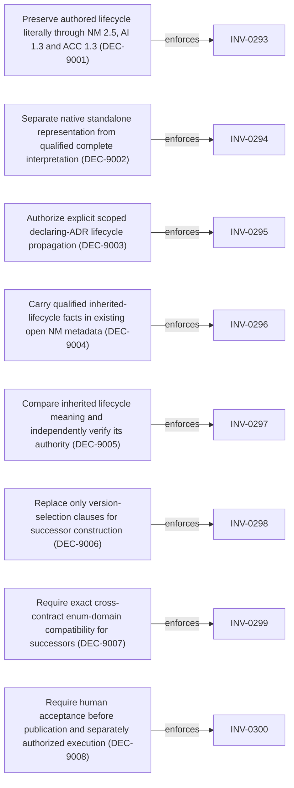

<!--
integrity_schema_version: 1
generated: deterministic_projection_v1
artifact_kind: rendered_adr_markdown
generator_id: adr-projection-markdown
generator_version: 3
hash_algorithm: sha256
source_hash: 4abdbf238dcb7ecc2e31c013bf42a55892fb67a4d6b6146b3304dacf47f1d99e
rendered_hash: 6ad6ab621748bc8666ac79809296cccd8dbaf901e118d3c3dce1ee35bed4b05d
-->

# ADR-L-0037: Lossless Authored Lifecycle and Declaring-ADR Provenance

## Identity / Status

**Type:** logical 
**Status:** accepted 
**Alias:** ADR-L-0037 
**Authoring contract:** authoring v1.5 
**Created:** 2026-10-22 
**Authors:** erik.gallmann 
**Domains:** architecture, semantic-authority, authoring, conformance 
**Tags:** lifecycle, normalized-model-2.5, architecture-interpretation-1.3, authoring-construction-1.3 

## Architecture at a Glance

| | |
| --- | --- |
| Logical authority | ADR-L-0037 |
| Status | accepted |
| Decisions | 8 |
| Invariants | 8 |

## Context

Authoring 1.7 permits status accepted on adr/logical, adr/physical-system
and adr/physical-component. AI 1.2 assigns each status to entity_lifecycle_stage
through canonical_field_placement/exact_typed_value, but NM 2.4 permits only
proposed, active, deprecated and superseded. Therefore accepted is valid source
and invalid destination without a value change forbidden by accepted DEC-0271.
Historical accepted-to-active conversion is not forward semantic authority.

Historical regular embedded entity normalization also copies parent status,
while AI 1.2 supplies no explicit qualified inheritance rule. Native standalone
decisions have no authored status at all. DEC-0273 and INV-0279 preserve native
fragment roots; their interpretation guarantee needs an explicit successor
qualification rather than invented owner context or synthetic ADR wrappers.

This accepted logical ADR records the selected successor direction and the
missing semantic authority. Human acceptance of PR #173 at reviewed commit
7f3272b5b2e2bb8736a73d95c7b8a3d0f32c06c3 authorizes this lifecycle
transition. It does not amend frozen contracts or resume the blocked AI
execution slice before successor publication.
## Architectural Decisions

| Decision | Choice | Traceability |
| --- | --- | --- |
| DEC-9001 | Preserve authored lifecycle literally through NM 2.5, AI 1.3 and ACC 1.3 | Enforces INV-0293; Refines Compare complete expected and observed semantic ledgers for construction round trips (DEC-0268), Require exact Architecture Interpretation dispositions for all supported Authoring 1.7 fields (DEC-0269) |
| DEC-9002 | Separate native standalone representation from qualified complete interpretation | Enforces INV-0294; Refines Define whole-result aggregation for documents, fragments, relationships, and unresolved semantics (DEC-0273) |
| DEC-9003 | Authorize explicit scoped declaring-ADR lifecycle propagation | Enforces INV-0295; Refines Require exact Architecture Interpretation dispositions for all supported Authoring 1.7 fields (DEC-0269), Distinguish semantic provenance from candidate integrity and representation ceremony (DEC-0272), Define whole-result aggregation for documents, fragments, relationships, and unresolved semantics (DEC-0273) |
| DEC-9004 | Carry qualified inherited-lifecycle facts in existing open NM metadata | Enforces INV-0296; Refines Require exact Architecture Interpretation dispositions for all supported Authoring 1.7 fields (DEC-0269), Distinguish semantic provenance from candidate integrity and representation ceremony (DEC-0272) |
| DEC-9005 | Compare inherited lifecycle meaning and independently verify its authority | Enforces INV-0297; Refines Compare complete expected and observed semantic ledgers for construction round trips (DEC-0268), Require exact Architecture Interpretation dispositions for all supported Authoring 1.7 fields (DEC-0269), Distinguish semantic provenance from candidate integrity and representation ceremony (DEC-0272), Define whole-result aggregation for documents, fragments, relationships, and unresolved semantics (DEC-0273) |
| DEC-9006 | Replace only version-selection clauses for successor construction | Enforces INV-0298; Refines Compare complete expected and observed semantic ledgers for construction round trips (DEC-0268), Require exact Architecture Interpretation dispositions for all supported Authoring 1.7 fields (DEC-0269), Produce complete Normalized Model results using a deterministic detached context (DEC-0270), Distinguish semantic provenance from candidate integrity and representation ceremony (DEC-0272), Define whole-result aggregation for documents, fragments, relationships, and unresolved semantics (DEC-0273), Bind one composition intent to one governed containment row or fail closed (DEC-0274), Resolve composition endpoints only to same-request fragment request keys (DEC-0275), Let the compiler write the selected parent property from separate prepared children (DEC-0276), Treat ordering as parent membership sequence and never as child identity (DEC-0277), Require semantic, integrity, and diagnostic evidence before composition execution can be reported (DEC-0278), Qualify the composition-binding table inside immutable ACC 1.2 resource closure (DEC-0279) |
| DEC-9007 | Require exact cross-contract enum-domain compatibility for successors | Enforces INV-0299 |
| DEC-9008 | Require human acceptance before publication and separately authorized execution | Enforces INV-0300 |

### DEC-9001 — Preserve authored lifecycle literally through NM 2.5, AI 1.3 and ACC 1.3

**Rationale**

The selected successor chain is Authoring 1.7 to Architecture Interpretation
1.3 to Normalized Model 2.5, selected by Authoring Construction 1.3. For
adr/logical, adr/physical-system and adr/physical-component, status maps to
lifecycle_stage without changing the typed value: proposed to proposed,
accepted to accepted, deprecated to deprecated and superseded to superseded.
The inverse over that four-value source image is the identity mapping.
Normalized Model 2.5 adds accepted to the regular entity lifecycle domain and
retains active for independently qualified uses. active has no inverse to an
Authoring 1.7 ADR status under this rule. Neither accepted nor inherited
accepted proves implementation, deployment, operation, effectivity or admission.

DEC-0271 remains unchanged: canonical_field_placement is exact and lossless;
value-changing normalization, fallback and field loss remain mismatch. Authored
status is semantic, never ceremony. No accepted-to-active conversion is
authorized. Schema permission for active is not an AI mapping or default.
Historical mapping behavior supplies evidence of intent, not forward authority.

**Alternatives Considered**

| Alternative | Rejected because |
| --- | --- |
| Reversible accepted-to-active mapping under successor AI authority | A bijection of strings does not establish equivalent meaning; preserving accepted avoids imposing that equivalence. |
| Preserve accepted only in metadata while emitting active as lifecycle_stage | The first-class value would still change and a replay copy cannot repair the DEC-0271 mismatch. |
| Restrict forward construction to proposed ADRs | This leaves valid accepted authoring input without faithful forward interpretation. |

**Traceability**
- Enforces: INV-0293
- Refines: Compare complete expected and observed semantic ledgers for construction round trips (DEC-0268)
- Refines: Require exact Architecture Interpretation dispositions for all supported Authoring 1.7 fields (DEC-0269)

### DEC-9002 — Separate native standalone representation from qualified complete interpretation

**Rationale**

A native authoring_fragment remains an authorized source representation and a
minimal source root. Its artifact, canonical identity and exact bytes remain
available even when a later interpretation capability is unavailable. No
synthetic ADR, owner, lifecycle status or context may be invented to satisfy a
normalized schema. In particular, native entity/decision has no independent
authored lifecycle status in Authoring 1.7.

For successor construction, narrow only DEC-0273's unconditional promise that
a standalone authoring_fragment is interpreted as a native semantic unit:
native interpretation is successful only when every required semantic fact,
including lifecycle provenance, is independently qualified by selected exact
authority. Missing lifecycle provenance produces Unavailable, not fabricated
semantics or an Unresolved reference that no resolver has established. Retain
all independent violations under Rejected > Unavailable > Unresolved.
Do not expose a partial model as complete interpretation or Constructed.

INV-0279's native-root, minimal-basis, exactly-once and no-wrapper obligations
are retained. They guarantee representation and accounting, not that all
required normalized values exist. A reference to an ADR, a request key, a
filename or root position does not establish declaring ownership. This ADR
does not authorize a new standalone owner-selection mechanism. Standalone
units without qualified lifecycle provenance remain blocked; existing
lifecycle-free normative propositions retain their separately governed rules.
Historical authority and conformance are not retroactively narrowed.

**Traceability**
- Enforces: INV-0294
- Refines: Define whole-result aggregation for documents, fragments, relationships, and unresolved semantics (DEC-0273)

### DEC-9003 — Authorize explicit scoped declaring-ADR lifecycle propagation

**Rationale**

AI 1.3 shall publish an explicit semantic ownership rule for embedded built-in
entity/boundary, entity/capability, entity/component, entity/contract,
entity/data_flow, entity/decision, entity/evidence_expectation, entity/gap,
entity/implementation_decision, entity/interface, entity/invariant,
entity/system and entity/system_boundary. For each actually selected source
schema occurrence, independently qualify its unique declaring ADR canonical
UUID, exact parent semantic type and schema-governed ownership path. The
child's lifecycle_stage equals that declaring ADR's literal authored status.
The lifecycle describes the architectural declaration, not independent child
approval or operational state. A schema-owned system descriptor sharing its
ADR identity does not manufacture a second semantic unit or lifecycle owner;
the existing source mapping identity rules still govern that case.

The future AI rule catalog must enumerate exact parent/child/schema ownership
selectors; the type list alone does not authorize arbitrary containment. A
verified ACC binding can prove ownership only for its selected containment.
This rule does not authorize additional composition bindings or compiler
insertion paths. References are not definitions and do not propagate lifecycle.
Duplicate or ambiguous declaring ownership cannot be resolved by traversal.

Normative propositions remain lifecycle-free. Custom entities, relationships,
owner-local topology values and standalone units lacking qualified declaring
context acquire no lifecycle rule here. Custom existence_state is a separate
semantic domain. A missing rule is unavailable, never an implicit fallback.
Propagation is explicitly governed semantic interpretation, not ceremony or
an authored child field. It changes no child identity or source bytes.

**Traceability**
- Enforces: INV-0295
- Refines: Require exact Architecture Interpretation dispositions for all supported Authoring 1.7 fields (DEC-0269)
- Refines: Distinguish semantic provenance from candidate integrity and representation ceremony (DEC-0272)
- Refines: Define whole-result aggregation for documents, fragments, relationships, and unresolved semantics (DEC-0273)

### DEC-9004 — Carry qualified inherited-lifecycle facts in existing open NM metadata

**Rationale**

Use /metadata/ai_lifecycle_provenance on the normalized child, with its closed
schema and meaning defined solely by an exact AI 1.3 resource. NM's existing
open metadata object is sufficient; no new NM envelope property is required.
The child's id carries its canonical UUID and lifecycle_stage carries the
inherited literal value. The carrier contains declaring_adr_id,
declaring_adr_semantic_type, status_semantic_field_key, status_source_authority,
ownership_rule and value_destination. value_destination is the fixed normalized
semantic destination /lifecycle_stage, not a runtime source locator.

status_source_authority qualifies Authoring 1.7 and the exact schema resource
key, digest and schema selector for the declaring status. ownership_rule
qualifies AI 1.3 by family/version/SCF plus exact rule resource key, digest and
rule identifier. The selected rule must in turn qualify the exact source
ownership selectors. Publication schemas must be closed and preserve these
facts without coercion. No enclosing SCF is embedded recursively in its own
resource closure; instance qualifications are populated after publication.

Do not duplicate lifecycle_stage as a second mutable value in the carrier.
Verify its value against the qualified declaring source. A missing carrier,
wrong child association, owner, status selector, rule, authority or destination
prevents complete qualification. Independently verify ownership and value from
the sealed source basis; metadata assertions alone are not proof. Runtime
source pointers, paths and array positions may locate evidence but never
identify the declaring owner. Generic NM consumers gain no intrinsic meaning
for this object without exact AI qualification.

AI 1.3 shall declare a contextual semantic-fact catalog, separate from authored
field coverage, with the stable key context/declaring_adr_lifecycle# matched
inside the child's canonical semantic identity. This is a narrow extension to
DEC-0269's authored-schema-relative key model: the contextual key is not a
pretend Authoring child field. Its destination schema and closed fact inventory
are selected from the AI closure. Existing source field keys remain unchanged.
There is no sixth implicit disposition class or ceremony exception.

**Traceability**
- Enforces: INV-0296
- Refines: Require exact Architecture Interpretation dispositions for all supported Authoring 1.7 fields (DEC-0269)
- Refines: Distinguish semantic provenance from candidate integrity and representation ceremony (DEC-0272)

### DEC-9005 — Compare inherited lifecycle meaning and independently verify its authority

**Rationale**

Expected and observed whole-ledger projections must compare the complete
literal lifecycle value under the child's semantic identity. They must also
compare contextual provenance under context/declaring_adr_lifecycle#: declaring
ADR UUID and semantic type, stable source status field identity and governing
ownership rule meaning. These facts qualify whose declaration the child
represents and cannot disappear as provenance-only metadata. The contextual
entry binds to the one first-class lifecycle value rather than replaying that
value as another independently owned semantic field.

Exact AI and Authoring qualifications, schema/resource digests and source
locations must be independently verified. Incidental source locations and
digests are integrity evidence, not owner identity or replacements for semantic
comparison. Rule identity and any qualification that defines its meaning must
be matched under the same exact selected authority; no cross-version rule
equivalence or ambient substitution is inferred. Missing, additional, changed
or ambiguous contextual facts fail whole-result equality. Changing accepted to
active is a mismatch even when a replay copy retains accepted. Preserve all
DEC-0271 difference rules and DEC-0272 semantic/integrity partitions.

**Traceability**
- Enforces: INV-0297
- Refines: Compare complete expected and observed semantic ledgers for construction round trips (DEC-0268)
- Refines: Require exact Architecture Interpretation dispositions for all supported Authoring 1.7 fields (DEC-0269)
- Refines: Distinguish semantic provenance from candidate integrity and representation ceremony (DEC-0272)
- Refines: Define whole-result aggregation for documents, fragments, relationships, and unresolved semantics (DEC-0273)

### DEC-9006 — Replace only version-selection clauses for successor construction

**Rationale**

This accepted decision governs successor construction only after separate
successor publication. It does not rebind any historical operation. The
following are prospective clause replacements, not whole-decision retirement:

ADR-L-0034 DEC-0268: select ACC 1.3, AI 1.3 and NM 2.5 for successor complete
ledger construction; retain complete comparison and identity/multiplicity.
DEC-0269: replace AI 1.2/ACC 1.1/NM 2.4 selection and the unchanged-NM claim;
retain field coverage and add only the explicit contextual fact mechanism.
DEC-0270: replace the NM target only, retaining detached domains and derivation.
DEC-0271: no supersession. DEC-0272: refine qualified lifecycle provenance only.
DEC-0273: narrowly qualify standalone interpretation as specified above.
INV-0276: replace the NM 2.4 target by NM 2.5 for successor results only.
INV-0277: replace AI 1.2 selection by AI 1.3 and qualify contextual fact coverage.
INV-0278: unchanged. INV-0279 and INV-0280: retain all existing principles and
clarify conditional interpretation and lifecycle provenance participation.

ADR-L-0035 DEC-0274 through DEC-0279: carry their endpoint, binding, ownership,
ordering, preservation and evidence semantics forward, replacing only the
successor ACC/AI/NM version references, composition-binding resource selections
and qualification targets by ACC 1.3/AI 1.3/NM 2.5. The successor binding keys
are authoring-construction/1.3/composition-bindings and its .schema companion;
row selection remains exact and independently content qualified. No additional
binding row is authorized. INV-0284 and INV-0292 receive those prospective
authority-selector replacements only. INV-0285 through INV-0291 retain their
substantive requirements; version-scoped historical statements remain true.
ACC 1.3 must have its own frozen conformance namespace, not rebind ACC 1.2's.

The canonical refines relationships express this clause-level evolution.
Do not use a whole-entity supersedes edge to retire still-valid accepted
decisions or invariants. Old authority remains valid for its exact versions.
Current SCS selection and protocol 1.5 are unchanged; ACC 1.2 cannot select
unqualified AI 1.3 or NM 2.5 through fallback or host options.

**Traceability**
- Enforces: INV-0298
- Refines: Compare complete expected and observed semantic ledgers for construction round trips (DEC-0268)
- Refines: Require exact Architecture Interpretation dispositions for all supported Authoring 1.7 fields (DEC-0269)
- Refines: Produce complete Normalized Model results using a deterministic detached context (DEC-0270)
- Refines: Distinguish semantic provenance from candidate integrity and representation ceremony (DEC-0272)
- Refines: Define whole-result aggregation for documents, fragments, relationships, and unresolved semantics (DEC-0273)
- Refines: Bind one composition intent to one governed containment row or fail closed (DEC-0274)
- Refines: Resolve composition endpoints only to same-request fragment request keys (DEC-0275)
- Refines: Let the compiler write the selected parent property from separate prepared children (DEC-0276)
- Refines: Treat ordering as parent membership sequence and never as child identity (DEC-0277)
- Refines: Require semantic, integrity, and diagnostic evidence before composition execution can be reported (DEC-0278)
- Refines: Qualify the composition-binding table inside immutable ACC 1.2 resource closure (DEC-0279)

### DEC-9007 — Require exact cross-contract enum-domain compatibility for successors

**Rationale**

Successor publication must resolve exact qualified source and destination
schema closures, including local and relative references and applicable
constraints. For exact field placement, prove every permitted source enum
value is accepted by the selected normalized destination without changing its
typed value. For inherited lifecycle, perform the same check from the qualified
declaring ADR status domain to every selected child lifecycle destination.
Missing references, ambiguous applicable branches or unestablished domain
inclusion prevent successor publication; a successful spot check is not a
domain proof. Do not silently ignore schema constraints or infer conversion.

Record the existing AI 1.2 status contradiction as a historical compatibility
finding: for all three ADR roots, accepted is allowed by Authoring 1.7, required
unchanged by AI 1.2 and excluded by NM 2.4. Do not edit frozen bytes, change old
SCFs or vectors, or retroactively fail historical publication/conformance under
a new acceptance rule. Existing integrity checks retain their original scope.
The new guard applies to successor publication; a historical diagnostic probe
can demonstrate the finding without reclassifying old frozen cases as failed.

Future positive/negative conformance must cover all four statuses for all three
ADR roots, every selected embedded type/owner selector, lifecycle-free NP,
missing/ambiguous/wrong owners, unsupported custom and standalone cases, forged
carrier facts, wrong rule/qualification, absent metadata, changed enum domains,
exact equality, reference-only nonownership and request/source permutations.
No case passes solely because its schema or provenance copy validates.

**Traceability**
- Enforces: INV-0299

### DEC-9008 — Require human acceptance before publication and separately authorized execution

**Rationale**

Human review and acceptance of PR #173 at commit
7f3272b5b2e2bb8736a73d95c7b8a3d0f32c06c3 authorizes ADR acceptance.
This acceptance publishes no NM 2.5, AI 1.3 or ACC 1.3 bytes,
implements no interpreter, and does not authorize Constructed or protocol work.

After acceptance, publish NM 2.5 first, then independently fingerprinted AI 1.3
selecting Authoring 1.7 and NM 2.5 with qualified lifecycle ownership/carrier
rules, then independently fingerprinted ACC 1.3 selecting those exact closures
and successor composition/equality qualification. Publication and execution
remain separate; use exact family/version/fingerprint and resource digests.
Do not change the current selected semantic-contract set as a publication side
effect. Preserve ADC 1.1, CEC 1.0 and all existing frozen resources.

Historical results retain their original qualified meaning. Migration requires
explicit re-interpretation of retained source under successor authority; never
blindly rewrite historical active to accepted, infer source status from that
value, or mutate retained artifacts. Consumer enum models and validators must
adopt the successor explicitly before reading accepted as a lifecycle value.
Then authorize bounded Rust execution, complete NM assembly, expected/observed
ledgers and whole-result equivalence in separate reviewed slices. No persistence,
promotion, new composition rows or complete construction capability is enabled
by this governance change.

**Traceability**
- Enforces: INV-0300

## Invariants

| Invariant | Requirement | Enforcement | Verification |
| --- | --- | --- | --- |
| INV-0293 | Successor interpretation MUST preserve each authored ADR status literally; accepted MUST NOT become active,… | MUST / design | automated |
| INV-0294 | Native standalone fragments MUST remain roots without synthetic ADRs; complete interpretation MUST remain… | MUST / design | automated |
| INV-0295 | Inherited lifecycle MUST equal the unique qualified declaring ADR status for an explicitly selected built-in… | MUST / design | automated |
| INV-0296 | Every inherited lifecycle MUST have independently verified AI-qualified metadata.ai_lifecycle_provenance bound to… | MUST / design | automated |
| INV-0297 | Whole-ledger equality MUST compare the literal lifecycle and meaning-bearing contextual provenance under child… | MUST / design | automated |
| INV-0298 | Successor construction MUST select exact ACC 1.3, AI 1.3 and NM 2.5 authority after publication; historical… | MUST / design | automated |
| INV-0299 | Successor publication MUST prove exact source enum-domain inclusion in every selected normalized destination,… | MUST / design | automated |
| INV-0300 | Acceptance of this ADR MUST NOT be treated as contract publication, interpreter implementation, Constructed support,… | MUST / design | automated |

### INV-0293

**Statement**

Successor interpretation MUST preserve each authored ADR status literally; accepted MUST NOT become active, ceremony, a default, or evidence of deployment.

**Scope:** semantic-authority

**Enforcement:** MUST (design)
**Verification:** automated

**Rationale**

Preserve authored lifecycle literally through NM 2.5, AI 1.3 and ACC 1.3.

**Upheld by decisions**
- Preserve authored lifecycle literally through NM 2.5, AI 1.3 and ACC 1.3 (DEC-9001)

### INV-0294

**Statement**

Native standalone fragments MUST remain roots without synthetic ADRs; complete interpretation MUST remain Unavailable when required lifecycle provenance cannot be qualified.

**Scope:** semantic-authority

**Enforcement:** MUST (design)
**Verification:** automated

**Rationale**

Separate native standalone representation from qualified complete interpretation.

**Upheld by decisions**
- Separate native standalone representation from qualified complete interpretation (DEC-9002)

### INV-0295

**Statement**

Inherited lifecycle MUST equal the unique qualified declaring ADR status for an explicitly selected built-in ownership rule; reference-only, custom, owner-local and unqualified standalone contexts MUST NOT acquire that rule.

**Scope:** semantic-authority

**Enforcement:** MUST (design)
**Verification:** automated

**Rationale**

Authorize explicit scoped declaring-ADR lifecycle propagation.

**Upheld by decisions**
- Authorize explicit scoped declaring-ADR lifecycle propagation (DEC-9003)

### INV-0296

**Statement**

Every inherited lifecycle MUST have independently verified AI-qualified metadata.ai_lifecycle_provenance bound to the child UUID, declaring ADR UUID, exact status source and governing ownership rule; source locations MUST NOT become owner identity.

**Scope:** semantic-authority

**Enforcement:** MUST (design)
**Verification:** automated

**Rationale**

Carry qualified inherited-lifecycle facts in existing open NM metadata.

**Upheld by decisions**
- Carry qualified inherited-lifecycle facts in existing open NM metadata (DEC-9004)

### INV-0297

**Statement**

Whole-ledger equality MUST compare the literal lifecycle and meaning-bearing contextual provenance under child identity and the stable AI-owned contextual key; integrity digests and replay copies MUST NOT substitute for semantic equality.

**Scope:** semantic-authority

**Enforcement:** MUST (design)
**Verification:** automated

**Rationale**

Compare inherited lifecycle meaning and independently verify its authority.

**Upheld by decisions**
- Compare inherited lifecycle meaning and independently verify its authority (DEC-9005)

### INV-0298

**Statement**

Successor construction MUST select exact ACC 1.3, AI 1.3 and NM 2.5 authority after publication; historical authorities, SCFs, conformance and protocol 1.5 MUST remain immutable and MUST NOT silently select successor semantics.

**Scope:** semantic-authority

**Enforcement:** MUST (design)
**Verification:** automated

**Rationale**

Replace only version-selection clauses for successor construction.

**Upheld by decisions**
- Replace only version-selection clauses for successor construction (DEC-9006)

### INV-0299

**Statement**

Successor publication MUST prove exact source enum-domain inclusion in every selected normalized destination, including inherited lifecycle destinations; missing or ambiguous qualification MUST block publication without retroactively changing historical acceptance criteria.

**Scope:** semantic-authority

**Enforcement:** MUST (design)
**Verification:** automated

**Rationale**

Require exact cross-contract enum-domain compatibility for successors.

**Upheld by decisions**
- Require exact cross-contract enum-domain compatibility for successors (DEC-9007)

### INV-0300

**Statement**

Acceptance of this ADR MUST NOT be treated as contract publication, interpreter implementation, Constructed support, persistence or promotion; successor publication and execution MUST remain separate reviewed steps.

**Scope:** semantic-authority

**Enforcement:** MUST (design)
**Verification:** automated

**Rationale**

Require human acceptance before publication and separately authorized execution.

**Upheld by decisions**
- Require human acceptance before publication and separately authorized execution (DEC-9008)

## Decision / Intent Traceability

### Decision Traceability

## Governance / Bindings / Evidence

### Governance

**Approved by:** egallmann
**Approved date:** 2026-10-22 16:53:50+00:00

## Lifecycle / Related Architecture

**Related ADRs**
- [ADR-L-0032](ADR-L-0032-candidate-source-representation-and-round-trip-basis-authority.md)
- [ADR-L-0034](ADR-L-0034-detached-normalized-semantic-equivalence-for-authoring-construction.md)
- [ADR-L-0035](ADR-L-0035-governed-composition-intent-binding-for-authoring-construction.md)

**References**
- [ADR-L-0032](ADR-L-0032-candidate-source-representation-and-round-trip-basis-authority.md)
- [ADR-L-0034](ADR-L-0034-detached-normalized-semantic-equivalence-for-authoring-construction.md)
- [ADR-L-0035](ADR-L-0035-governed-composition-intent-binding-for-authoring-construction.md)
- [ADR-L-0038](ADR-L-0038-explicit-required-output-authority-across-the-ai-catalog.md)

## Architecture Relationships

| Neighbor | Relationship | Exact Path |
| --- | --- | --- |
| [ADR-L-0034 — Detached Normalized Semantic Equivalence for Authoring Construction](ADR-L-0034-detached-normalized-semantic-equivalence-for-authoring-construction.md) | refines | `DEC-9001 -[:refines]-> DEC-0268` |
| [ADR-L-0035 — Governed Composition-Intent Binding for Authoring Construction](ADR-L-0035-governed-composition-intent-binding-for-authoring-construction.md) | refines | `DEC-9006 -[:refines]-> DEC-0274` |
| [ADR-L-0038 — Explicit Required-Output Authority Across the AI Catalog](ADR-L-0038-explicit-required-output-authority-across-the-ai-catalog.md) | refines | `DEC-9013 -[:refines]-> DEC-9005` |

## Notes

Accepted following explicit human review and acceptance of PR #173 at commit
7f3272b5b2e2bb8736a73d95c7b8a3d0f32c06c3. Governance approval metadata
records that authorization; it does not assert a steelman review or grant
runtime execution authority. Stable entity identities and aliases are retained.
The local ignored Design Journal is convergence state, not runtime authority
or a required PR artifact. Derived projections and indexes are generated,
never independent authority. Historical published contracts remain unchanged.
NM 2.5, AI 1.3 and ACC 1.3 publication remain separate prerequisites before
resuming successor lifecycle interpretation.

---

*Generated from ADR-L-0037 by ADR Architecture Kit (projection v3)*